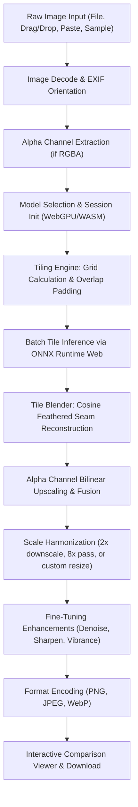

# MoUpscale — System Architecture

## 1. Overview
MoUpscale is a browser-first, client-side application engineered for deep-learning image super-resolution. The core philosophy is that zero user image data should ever be transmitted to external servers. High-performance tensor execution is achieved directly on the client machine using **ONNX Runtime Web**, with **WebGPU** hardware acceleration and **WebAssembly (WASM)** multi-threaded fallback.

---

## 2. End-to-End Image Processing Pipeline

---

## 3. Component Deep Dive

### 3.1. Preprocessing & Decoding
- **EXIF Handling:** Handled via browser `createImageBitmap(blob, { imageOrientation: 'from-image' })`, ensuring rotated phone pictures maintain proper upright orientation.
- **Color Representation:** Canvas ImageData (Uint8ClampedArray) is converted into NCHW tensor format `[1, 3, Height, Width]`, normalized to `[0.0, 1.0]`.
- **Alpha Channel:** Separated from RGB channels prior to neural inference to prevent color space artifacts on transparent pixels.

### 3.2. Smart Tiling & Feathered Seam Blending
To eliminate out-of-memory (OOM) failures on large images:
1. The input image is divided into a grid of overlapping patches (default 192px on mobile, 256px–384px on desktop).
2. Context padding (16px–32px) surrounds each tile so the neural network receives surrounding spatial context.
3. Overlapping regions are blended using a 2D cosine/linear feathered weight mask:
   $$\text{Weight}(x, y) = W_x(x) \times W_y(y)$$
4. The output is accumulated in a Float32 buffer and normalized by total accumulated weights, mathematically guaranteeing zero boundary seams or gridlines.

### 3.3. Runtime & Execution Providers
- **WebGPU:** Initialized when `navigator.gpu` returns a valid adapter. Bypasses CPU bottleneck by offloading tensor matrix multiplications directly to the local GPU.
- **WASM Fallback:** Uses multi-threaded WebAssembly with SIMD (Single Instruction Multiple Data) instructions, bounded by `navigator.hardwareConcurrency - 1` to prevent UI freezing.

### 3.4. Post-Processing Enhancement Engine
Output pixel data passes through a sequence of non-destructive filters:
- **Unsharp Masking:** Enhances edge gradient micro-contrast with a controlled radius.
- **Photometric Bilateral Denoising:** Smooths flat-area high-frequency noise while preserving edge boundaries.
- **JPEG Artifact Deblocking:** Softens 8x8 block boundary artifacts common in low-bitrate input images.
- **Alpha Reconstruction:** Bilinear/bicubic re-sampling of the original transparency mask, preserving crisp anti-aliased cutout edges.

### 3.5. Batch Execution & Memory Lifecycle
- Batch processing executes sequentially to maintain a strict memory ceiling.
- Intermediate `ort.Tensor` objects are explicitly disposed via `.dispose()`.
- Temporary object URLs are revoked upon replacement or component unmount.
- Neural model weights are stored in the browser's persistent `Cache` API.
